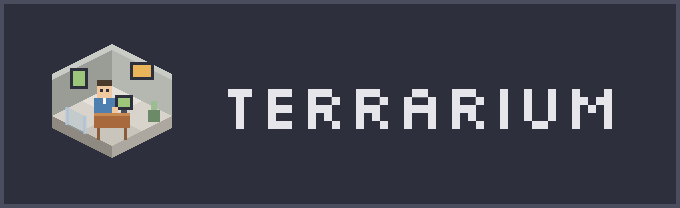
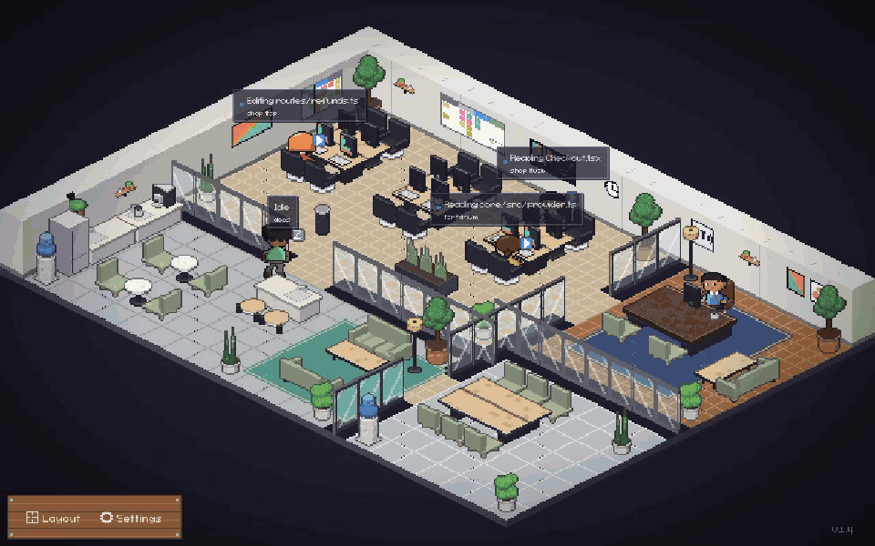

<h1 align="center">
  
</h1>

<p align="center">Every AI coding agent on your machine, as a pixel-art character in an isometric office.</p>

<p align="center"><a href="https://luckystrike561.github.io/terrarium/">Website</a> · <a href="docs/guide.md">User guide</a> · <a href="https://luckystrike561.github.io/terrarium/#agents">Supported agents</a> · <a href="CHANGELOG.md">Changelog</a></p>

<p align="center">
  
</p>

Terrarium turns each agent into a character. It types at a desk while its agent edits or runs commands, reads while it searches, queues at the CTO's office when the agent needs you, and rests in the lounge when it is done. A badge shows each state, and Claude Code agents get a context gauge, sub-agents and teammates.

It watches Claude Code, omp, Codex, OpenCode, Gemini CLI and 17 more CLIs through their own session stores, plus every agent in [herdr](https://github.com/herdrdev/herdr) panes, locally or over SSH. It never modifies your agents: its data lives in `~/.terrarium/`, and the only outside file it writes is `~/.claude/settings.json`, after you approve Claude hooks.

## Quick start

Node.js 22.13 or later. Terrarium runs from source (`npx terrarium` is an unrelated package).

```bash
git clone https://github.com/Luckystrike561/terrarium.git
cd terrarium && npm install && npm run build
node dist/cli.js --provider herdr,omp,codex   # any module ids, saved for later runs
```

Open the printed `http://127.0.0.1:<port>/?token=…` URL and keep it secret: the token lets a browser install hooks and add SSH connections. The [user guide](docs/guide.md#quick-start-per-provider) has the one-line setup and session store for each provider.

## Docker

```bash
docker run -d --name terrarium \
  -p 127.0.0.1:8790:8790 \
  -v "$HOME/.config/herdr:/home/node/.config/herdr:ro" \
  -v "$HOME/.omp/agent/sessions:$HOME/.omp/agent/sessions:ro" \
  -v terrarium-data:/home/node/.terrarium \
  ghcr.io/luckystrike561/terrarium:latest
docker logs terrarium   # prints the URL with its token
```

The image runs herdr and omp. Other providers, mounts, UID and Claude limits: [guide](docs/guide.md#docker).

## Development

```bash
npm run build && npm test && npm run e2e
npm run site:build     # website from site/ into dist/site/
```

[CLAUDE.md](CLAUDE.md) is the architecture reference, [CONTEXT.md](CONTEXT.md) the glossary, and [CONTRIBUTING.md](CONTRIBUTING.md) the workflow.

## License and credits

MIT, see [LICENSE](LICENSE). Terrarium is a fork of [Pixel Agents](https://github.com/pixel-agents-hq/pixel-agents) v1.4.1 by Pablo De Lucca and its contributors.
