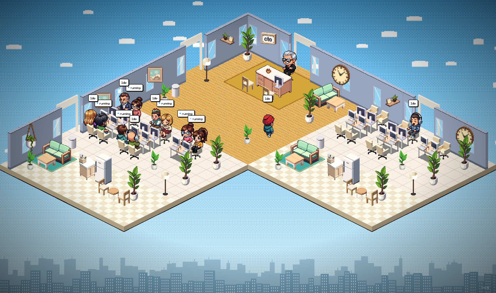

# Art direction

The target look for everything drawn in the office: the background, the room shell (floors, walls, partitions), furniture, characters, the pet bubble and the HUD. New art follows this note. Art that cannot follow it changes the note in the same pull request.

## Decisions

- **Furniture, characters and floors are AI-generated with PixelLab; the room shell is drawn procedurally at runtime.** Each of the 38 furniture ids, each of the 12 workers plus the CTO, and each of the 9 floor materials is generated by [PixelLab](https://pixellab.ai) from a text description and a seed, recorded in `scripts/pixellab/furniture.json`, `scripts/pixellab/cast.json` and `scripts/pixellab/floors.json` respectively, not drawn by code. `scripts/pixellab/generate.ts`, `furniture.ts` and `floors.ts` call PixelLab and pack the raw frames into the bundled sheets. The walls, the floor slab and the background stay procedural at runtime (`webview-ui/src/office/isoWalls.ts`, `backdrop.ts`): no hand-drawn sheets and no third-party asset packs for those either.
- **Nothing is copied from another game, and nothing is fetched at runtime.** Every generated asset is PixelLab's own output from Terrarium's own prompts, not traced, sampled or styled after a reference image. PixelLab's terms of service give the generating account ownership of its outputs and a commercial licence to them, so the art ships under this repo's own MIT licence, in the npm tarball and the Docker image, with no shim and no attribution requirement beyond PixelLab's own branding in this document.
- **Cozy modern office.** Light wood tones, white and soft pastel colours, plants, clean minimalist shapes, soft daylight. Furniture and floors share one prompt suffix so every generated item reads as one room; characters share their own suffix so the whole cast reads as one style.
- **Readable first.** A viewer across the room must tell who is working, who is waiting and who needs approval without reading a badge.

## Pixel grid and projection

- 2:1 isometric: a floor tile is a 64×32 diamond in art pixels. The world keeps its 32×16 grid units, and every generated sprite is authored at `ART_SCALE` (2) art pixels per world unit and drawn at half size, so the layout, the footprints and the simulation are unchanged while the art carries full PixelLab detail. Heights in world units: desk tops at 12, chair seats at 6, back walls 56 tall, glass partitions 30 (twice that in art pixels).
- Nearest-neighbour sampling only. No anti-aliasing, no blur, no sub-pixel placement, no smooth gradients. Shading comes in hard bands on the room shell, and PixelLab's own `medium shading` setting on furniture and characters.
- Every outline and detail is one art pixel, half a world unit. Never scale a sprite inside its sheet.

## Background

A sunny sky and a daytime city, drawn by `backdrop.ts`:

- **Sky** in hard horizontal bands, `#4aa6e0` at the top through `#7cc4ec` and `#a8daf3` to `#d2eef9` at the horizon.
- **Clouds**: flat white `#ffffff` puffs with a `#cfe9f7` underside, stepped like pixel art, never round gradients.
- **City** along the bottom: two rows of daytime towers, far `#9fc6dc` and near `#7aaac6`, with pale `#e3f4fb` windows in a grid, and a few rooftop details. No stars, no lit windows.

## Light

One key light from the screen's upper left.

| Surface                                       | Brightness |
| --------------------------------------------- | ---------- |
| Top faces                                     | 100%       |
| Left faces (facing +row, screen lower left)   | 80%        |
| Right faces (facing +col, screen lower right) | 60%        |

- **Shadows shift toward a cool grey-blue `#2c3446`**, never toward black. The room shell (walls, floor slab, glass partitions) quantizes brightness into hard bands; furniture's shading is PixelLab's own `medium shading` setting instead.
- **Gloss**: the room shell's lacquered edges carry a white highlight streak or a lighter rim on their top front edges.
- **Contact shadows**: characters stand on a translucent `#00000033` iso ellipse, furniture casts its traced shadow on the floor.

## Outline

- **Ink is `#111111`.** It outlines characters, furniture, the pet bubble, windows and the floor slab.
- **Characters** get a full 1 px black outline: PixelLab is generated with `outline: single color black outline`, so the silhouette and the lines between overlapping parts (an arm over the torso, a hand over a held sheet) come out of the model, not hand-drawn.
- **Furniture** gets a full 1 px outline: PixelLab is generated with `outline: single color outline`, so the silhouette and the lines between overlapping parts come out of the model, not hand-drawn.
- **Floors** carry each material's own grid (grout, plank seams, brick coursing, checker squares) baked into the PixelLab art instead of a drawn outline. **Walls** get an ink line along the top edges of the cap.

## Room shell

- **Floor tiles** read as a grid through each material's own baked-in pattern (grout lines, plank seams, brick coursing, checker squares), projected onto a 64×32 diamond at render time. `floor_0`–`floor_8` keep their index-to-material mapping (`floor_0` plain polished slab, `floor_1` large pale tile, `floor_2` large tile with dark grout, `floor_3` small tile, `floor_4` wood planks, `floor_5` running-bond brick, `floor_6` aligned brick, `floor_7` fine checkerboard, `floor_8` coarse checkerboard). They are [PixelLab](https://pixellab.ai) `tiles-pro` renders, generated and packed by `scripts/pixellab/floors.ts`; a room's `tileColors` entry tints a material with Adjust-mode HSL shifts, or leaves it untouched at `{h:0,s:0,b:0,c:0}`.
- **Floor slab**: the room stands on an 8 px thick slab: the left face a little darker than the floor, the right face darker still, outlined in ink along the bottom.
- **Back walls** are thin and tall: 56 px high and 4 world units thick, standing on the inner edge of their tile so wall items keep hanging on the same face. Flat wallpaper faces (left face 92%, right face 74% of the wall colour), a narrow cap at 115% with the ink line on its outer top edges, and a 3 px skirting board at 60%.
- **Glass partitions** stand 30 px high, an ink frame, a light cyan pane at 40% opacity and a white diagonal sheen.

## Palette

Base colours are the fully lit tone. Side tones come from the light. Keep bases light to mid and softly saturated, never garish.

| Role                | Colours                                                                           |
| ------------------- | --------------------------------------------------------------------------------- |
| Ink (outlines)      | `#111111`                                                                         |
| Text ink on paper   | `#222222`                                                                         |
| Shadow tint         | `#2c3446`                                                                         |
| Wood                | `#e0a463` `#c4824a` `#8e5530`                                                     |
| Plastic and lacquer | white `#f4f4f4`, red `#e04b3f`, blue `#3f8ee0`, yellow `#f2c23a`, green `#5cbf4a` |
| Upholstery          | teal `#4bb3b0`, orange `#ef8a3c`, cream `#efe3c4`                                 |
| Metal               | `#e8ecf0` `#b9c1cb` `#6f7884`                                                     |
| Paper               | `#ffffff` `#f4efe1`                                                               |
| Plants              | `#7ed957` `#4caf3c` `#2f7d2c`                                                     |
| Sky and city        | see Background                                                                    |

**State colours** are used by the HUD, and nothing else uses them:

| State             | Colour           |
| ----------------- | ---------------- |
| Working           | blue `#3794ff`   |
| Needs approval    | amber `#cca700`  |
| Waiting for input | violet `#7c5cff` |
| Done              | green `#44bb66`  |
| Idle              | grey `#8891a8`   |

## Characters

A frame is 96×96 art pixels, sized to fit PixelLab's native 88×88 animation frames with headroom for a raised hand or a held-up form. The feet touch a shared baseline near the bottom of the frame, on a translucent iso ellipse.

**Generated, not drawn.** Each of the 12 workers and the CTO is a [PixelLab](https://pixellab.ai) character, not a figure composed from parts: a standing character and a seated state, each generated from a text description (hair, skin tone, build, outfit and a dominant outfit colour distinct from every other worker's), in both `south-west` (DOWN) and `north-east` (UP) facings. The whole cast shares one prompt suffix so the style matches: chunky cute proportions, an oversized round head on a small simple body, a cheerful friendly expression, a cozy modern office worker, clean flat colours, charming pixel art style. `scripts/pixellab/cast.json` records every description, seed and PixelLab character/animation id; `scripts/pixellab/generate.ts` creates and downloads the raw frames and `scripts/pixellab/pack.ts` composes them into the bundled sheets.

**Seated pose, no props.** The seated state is PixelLab's own edit of the standing character (`seatedStateEditDescription`): both legs symmetric mirror images, both feet flat on the floor side by side, both knees bent at the same right angle, back straight, facing forward, chair not drawn (the layout's own chair art sits under it). Every seated animation (`type`, `read`, `rest`, `waveSeated`, `holdFormSeated`) keeps that same body and head fixed in place: no new object, no desk, no keyboard, no monitor, no furniture and no held prop ever enters frame, only the hands move. `pack.ts`'s growth guard (`PROP_GROWTH_THRESHOLD`) measures each animation's opaque pixel area against its first frame and fails the build if any direction's area grows past 145% of it, catching a prop the model slipped into a later frame before it reaches a bundled sheet.

**Views.** Row 0 faces DOWN (screen lower left, PixelLab's `south-west`), row 1 faces UP (screen upper right, PixelLab's `north-east`), row 2 faces RIGHT and is row 0 mirrored. LEFT is row 1 mirrored at runtime.

**Poses.** Every sheet carries the same 23 frames, in this order (`CHARACTER_FRAMES` in `core/src/assets/constants.ts`):

| Frames                                | Pose                                                                                                      | Used for                                         |
| ------------------------------------- | --------------------------------------------------------------------------------------------------------- | ------------------------------------------------ |
| `walk1` `walk2` `walk3`               | walk cycle, `walk2` is the passing pose                                                                   | walking                                          |
| `type1` `type2` `type3` `type4`       | seated, typing on an invisible keyboard, calm 4-frame loop with subtle hand motion over a fixed body/head | writing tools                                    |
| `read1` `read2` `read3` `read4`       | seated, reading a held sheet, calm 4-frame loop with subtle hand motion over a fixed body/head            | reading tools                                    |
| `idle1` `idle2`                       | standing, breathing gently                                                                                | standing idle                                    |
| `rest1` `rest2`                       | seated, leaning back relaxed, eyes closed                                                                 | lounge sofas, resting at a desk, the CTO's couch |
| `raiseHand1` `raiseHand2`             | standing, one hand raised above the head, waving                                                          | waiting for input, at the CTO's door             |
| `raiseHandSeated1` `raiseHandSeated2` | seated, one hand raised above the head, waving                                                            | waiting for input, on a CTO visitor chair        |
| `holdForm1` `holdForm2`               | standing, holding a sheet of paper up high on the opposite side from the waving hand                      | needs approval, at the CTO's door                |
| `holdFormSeated1` `holdFormSeated2`   | seated, holding a sheet of paper up high, opposite side                                                   | needs approval, on a CTO visitor chair           |

Seated frames put the hips at one shared height (`SEAT_RAISE_ART_PX`, 12 art pixels) and bend the legs forward. Each kind of seat then sinks its sitter to its own seat height (`SEAT_SINK_PX`) and pulls it toward the middle of a sofa or bench. Only working agents type or read. An agent that sits without working rests, and an agent that needs the human shows it with its body: a raised hand asks a question, a held-up form asks for a signature, on opposite sides so the two read apart from the front and the back.

**Variety.** Twelve distinct workers ship (`char_0.png` to `char_11.png`), so a twelve-agent office has no two alike: different hair, skin tone, build and outfit, each with its own dominant outfit colour distinct from every other worker's. Hue-shifted copies only appear from the thirteenth agent on. The CTO has a sheet of its own (`cto.png`) that no agent uses.

## Furniture

**Generated, not drawn.** Each of the 38 furniture ids is a [PixelLab](https://pixellab.ai) map-object render, not a primitive ray traced by code: a `front` view generated from a text description, mirrored into `right`. Seats, desks and long tables are turned into one PixelLab 8-direction object from that front render, whose `south-west` view is `front` and `north-east` view is `back` (mirrored into `left`), so every view of an item is one design and faces the way the layout places it. `scripts/pixellab/furniture.json` records every prompt, seed and PixelLab object id. `scripts/pixellab/furniture.ts` generates, crops and packs the art.

- **Style**: cozy modern office pixel art, light wood tones, white and soft pastel colours, clean minimalist shapes, soft daylight, the same outline and shading settings for every item so the set reads as one room.
- An item with footprint fw×fh is `(fw+fh)*16` px wide and its floor diamond touches the image's left, right and bottom edges, trimmed and centred from the generated render (never smooth-scaled; an integer upscale only if PixelLab placed the object small within its canvas).
- Electronics have an off and an on state, chained from the off render via `init_image` so the lit frame stays visually close to the dark one.
- Items that stand on a desk or the counter carry the surface height under them, and wall items hang with their centre at eye level, in their own sprite.

## The office

The default office (`scripts/iso-art/layout.ts`) is one room plan with four themed areas, each with its own floor and colours: an open work area, the CTO's office, a lounge and break corner with the coffee machine, a meeting room. Rooms are separated by glass partitions, the back walls carry wallpaper and wall items, plants and rugs break up the floor.

## Pet bubble

- One small sprite (11×13), `webview-ui/src/office/sprites/bubble-pet.json`, drawn in ink `#111111`. It floats above the pet's crown when a pet is petted.
- A white chat bubble with an ink outline and a tail pointing at the head, carrying a pink (`#e64566`) heart glyph: a reaction, not a state indicator.

## HUD

- **Modals and notices** are app windows: a white body, an ink border, a coloured title bar with white title text and a close button, rounded 4 px corners. Tooltips, toasts and in-world labels are small white rounded tags with an ink border.
- **Font**: FS Pixel Sans, at the theme's pixel sizes.
- **Shape**: 1 px or 2 px ink borders, small rounded corners, hard offset shadows (`2px 2px 0px`) with no blur, and no gradients.
- **Colours**: white, light grey, ink, the title bar blue `#2f80c0` and the state colours above. `npm run lint` enforces it: colour literals only in `constants.ts` and the CSS variables, pixel shadows, and the pixel font.

## References

Terrarium's own renders:

- [The default office](media/art-direction/office.png) at 1600×700 with twelve agents: five working, two needing approval, two waiting for input, three idle. This is the target state.
- [The office before this direction](media/art-direction/office-before.png), same scene and size, for comparison.
- [The twelve workers and the CTO](media/art-direction/characters.png), a contact sheet of all 13 generated character sheets.

## Checklist for new art

1. Furniture: generated by `scripts/pixellab/furniture.ts`, described and seeded in `scripts/pixellab/furniture.json`. Floors: generated by `scripts/pixellab/floors.ts`, described and seeded in `scripts/pixellab/floors.json`. Characters: generated by `scripts/pixellab/generate.ts` and packed by `scripts/pixellab/pack.ts`, described and seeded in `scripts/pixellab/cast.json`. A PixelLab rerun is not guaranteed byte-identical (the AI model is not deterministic) but keeps the same description, seed and framing.
2. Nothing traced, sampled or copied from another game, and nothing fetched at runtime. Furniture, characters and floors are PixelLab's own generated art from Terrarium's own prompts.
3. Daylit from the upper left, shadows toward `#2c3446`, colours from the palette above.
4. Outlined in ink as the section above says for its kind, fabric dithered, plastic glossy.
5. Characters: every frame of `CHARACTER_FRAMES` in all three rows, 96×96, feet at the shared baseline, no prop in any seated animation (the growth guard catches a regression).
6. Furniture: the footprint anchor contract above. `front` faces screen lower-left, and its long side runs along cols (screen upper-left to lower-right) for a footprint wider than it is deep.
